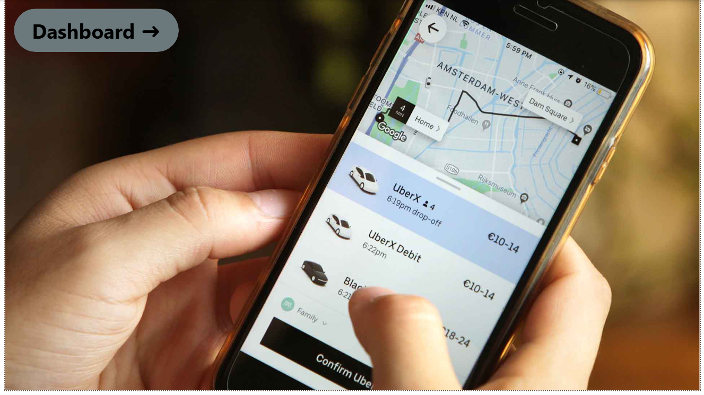
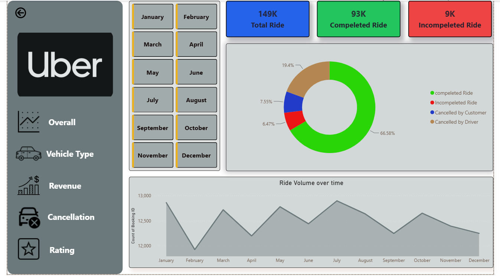
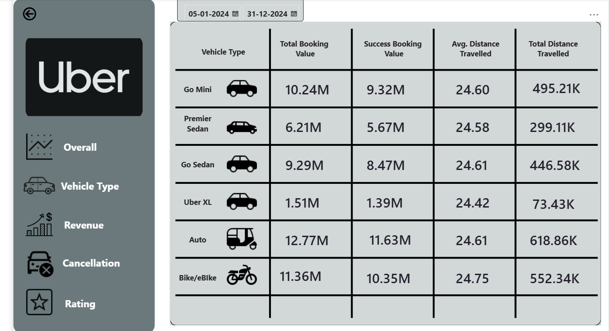
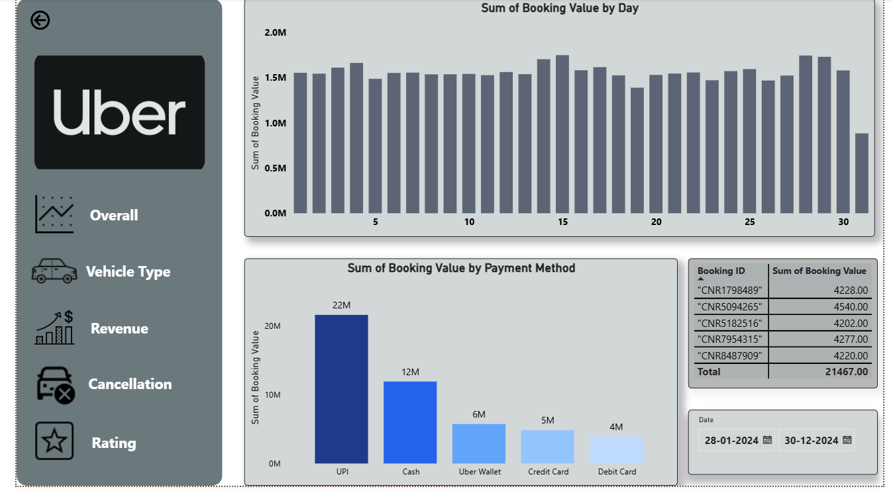
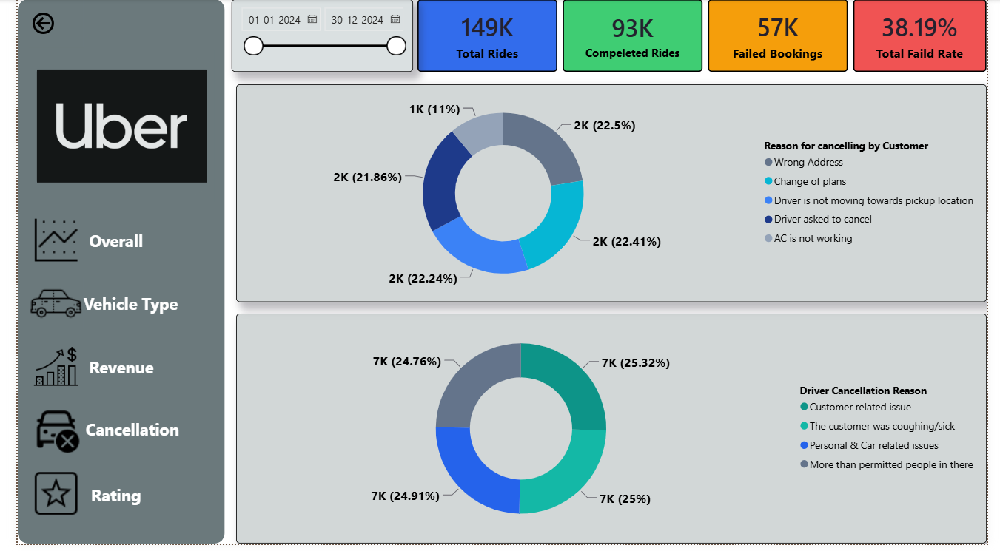
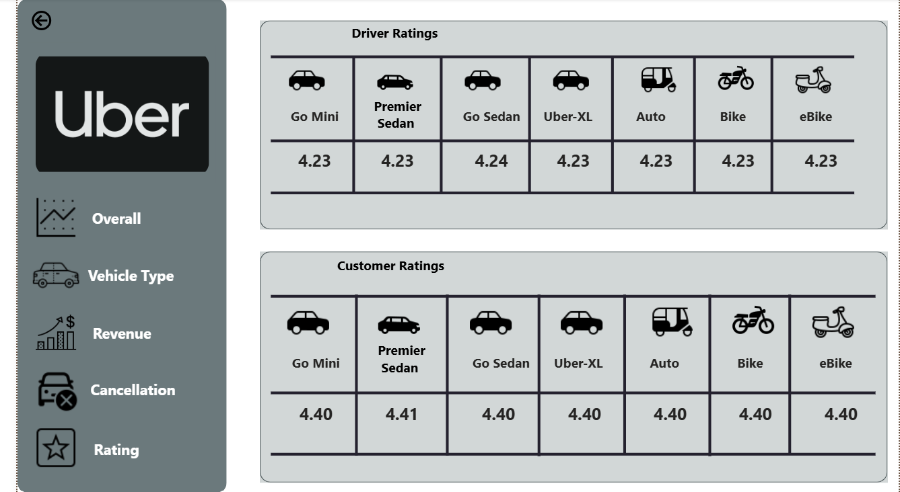

# Uber Ride Booking Analysis

## About the Project

This project is based on a 2024 Uber ride booking dataset. I cleaned the raw data using Python (Pandas) and created an interactive dashboard in Power BI to analyze booking trends, revenue, cancellations, vehicle performance, and customer and driver ratings.

The purpose of this project was to practice data cleaning, data modeling, DAX, and dashboard creation using a real-world dataset.

---

## Dataset

- Uber Ride Booking Dataset (2024)

---

## Data Cleaning

The dataset was cleaned in Python before importing it into Power BI.

The cleaning process included:

- Removing rows with missing dates
- Converting Excel serial dates into date format
- Converting the time column into time format
- Handling missing values
- Removing duplicate records
- Checking data types
- Exporting the cleaned dataset for Power BI

---

## Dashboard Pages

### Home
Navigation page for the dashboard.

### Overview
- Total Bookings
- Completed Bookings
- Failed Bookings
- Failed Booking Rate
- Monthly Booking Trend
- Booking Status Distribution

### Vehicle Analysis
- Total Booking Value
- Successful Booking Value
- Average Ride Distance
- Total Ride Distance
- Vehicle-wise Performance

### Revenue Analysis
- Revenue Trend
- Revenue by Payment Method
- Payment Method Distribution

### Cancellation Analysis
- Customer Cancellation Reasons
- Driver Cancellation Reasons
- Failed Ride Analysis

### Rating Analysis
- Customer Ratings
- Driver Ratings
- Vehicle-wise Rating Comparison

---

## KPIs

- Total Bookings
- Completed Bookings
- Failed Bookings
- Failed Booking Rate
- Total Revenue
- Average Booking Value
- Customer Rating
- Driver Rating

---

## Tools Used

- Python (Pandas)
- Power BI
- Power Query
- DAX
- Microsoft Excel

---

## Dashboard Preview

### Home

### Overview

### Vehicle Analysis

### Revenue Analysis

### Cancellation Analysis

### Rating Analysis

---

## Project Files

- Cleaned Dataset
- Python Data Cleaning Script
- Power BI Dashboard (.pbix)
- Dashboard Screenshots

---

## Author

**Shubham Uniyal**

Aspiring Data Analyst

### Skills

- SQL
- Python (Pandas)
- Power BI
- Excel

---

## Note

This project uses a 2024 Uber ride booking dataset for learning and portfolio purposes.
